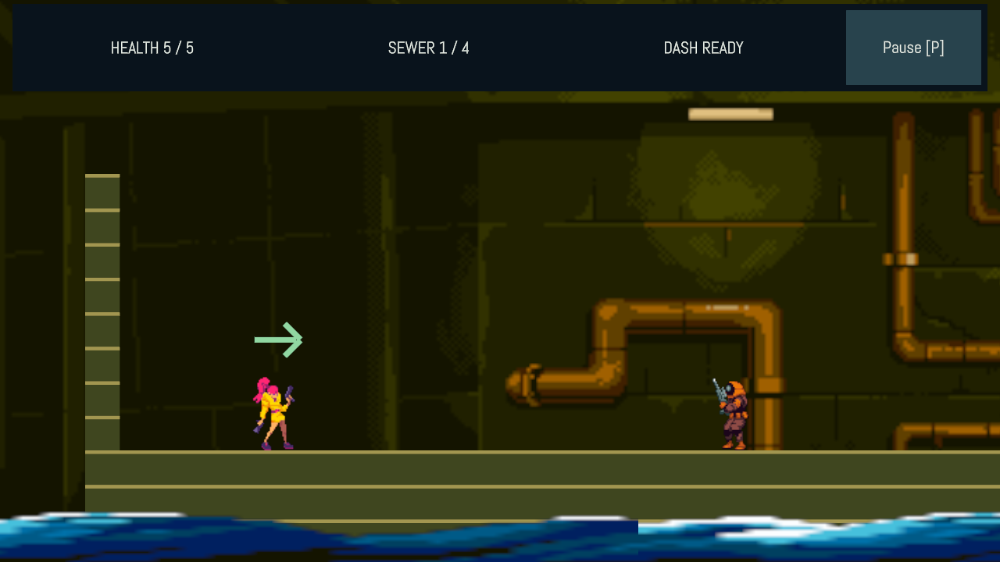
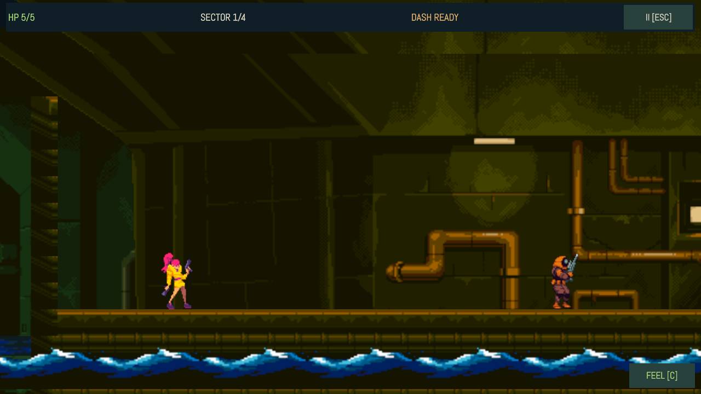
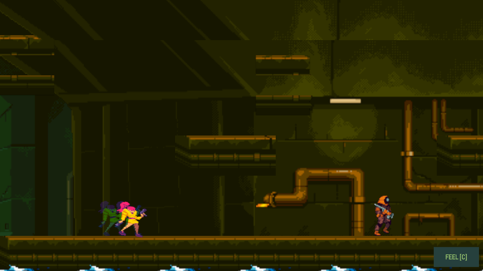

# Reference-directed recovery

Reference: https://deepnight.net/games/game-feel/ (Deepnight game-feel demo v2).

This recovery uses the supplied first-party sewer/player/soldier art. It adapts the reference's readable textured environment, responsive action presentation and discoverable feedback comparison; it does not reproduce its Inca artwork or character.

## Acceptance and ownership

- #66 environment: supplied edge/corner terrain strips, consistent environment proportions, unstretched water, repeating depth layers, clear actors and subdued guidance.
- #67 feedback: accepted-shot pose/recoil, directional dash silhouettes, takeoff/landing squash and dust, accepted damage/death/explosion camera impulses, frame-rate-correct decay and finite settling.
- #68 controls/UI: polished defaults, visible comparison controls, arrow/Space/mouse aliases, compact HUD, safe-area and 44-point controls, menu/phase cancellation.
- #69 integration: visual review, gameplay/replay verification, measured rendering/memory, architecture/performance review and repository CI.

The user explicitly requested coordinated subagents for this recovery. This supersedes the old one-chat-at-a-time workflow for these four tickets only. The previous experiment's cancelled issues remain cancelled. No recurring automation was resumed.

## Visual evidence

The baseline capture was taken with recorded ViewInfo 1280x720, matching screenshot size. An earlier portrait-ViewInfo capture was misleading and is not used for acceptance.

Checkpoint screenshots under evidence/ are inspection fixtures made by moving the player to safe authored checkpoints. The complete-route test and recorded input replay separately prove actual gameplay traversal and victory.

## Verification policy

Authored scenery transforms/entities, additional recorded input actions, and the new mouse-hold resource intentionally change full-world hashes. Existing recorded input was retained and rehashed through each tape's authored scene; gameplay assertions still check collision occupancy, movement, weapon cadence, enemy attacks, death/retry, checkpoints and victory. Baseline and Polished modes share final hash ad456cdff1eecb82 and rolling digest 94e92b24 for the complete route. Goldens were reviewed after intentional art/UI changes; image stability alone is not visual acceptance.

Render budgets were revised using measured scenario peaks (7–13 draws), retaining one draw of headroom for changed scenarios and the existing zero pipeline/long-GC requirements. This accounts for actual terrain and feedback that were absent from older captures; the overall phone-low draw guidance remains 50.

## Measurement limits

Fresh Android/desktop asset cooks pass. Phone-low reported peak residency is 6.87 MiB/192 MiB, textures 6.59 MiB/128 MiB and decoded audio 0.284MiB/32MiB. Native title skips 130/179 frames and caps at 30 fps. Release headless paused step p95 is 0.122 ms over 240 steps; the opaque pause cover suppresses world rendering.

These are desktop/native and headless measurements. Phone GPU time, sustained thermals and real low-end frame timing are unverified. Layered background fill has an estimated 2.67× source-average overlap and needs device measurement before choosing a cheaper phone-low presentation. Browser packaging is unavailable in this engine. Android package dry-run is blocked by the missing platform template; dual-runtime verification is blocked by the missing Hermes host.

Implementation details and focused verification are in ENVIRONMENT.md, FEEDBACK.md and CONTROLS.md. Final integrated results are recorded below when the gate completes.

## Integrated gate

167/167 V8 T0/T1 tests and all 10 unchanged-input replay verifications pass. Fresh pipeline recording completed across all scene profiles and GPU tiers; the union was unchanged because existing sprite/text/particle pipelines already cover these effects. The repository pre-push harness passes generation, formatting, phone-low render/structural checks, typechecking, validation, desktop cook and cooked smoke.

Architecture review has no unresolved must/should findings. Performance review has no remaining code blocker; the device measurement limitations above remain explicit. Native title work p95 was 0.796 ms; its first boot frame was 53.3 ms. Android asset cook passes, but package-size dry-run fails for the missing platform template. The attempted dual-runtime run fails for the missing Hermes host.

A separate 180-step scripted move/jump/dash/fire sample on the release desktop headless host measured sim-step p95 0.448 ms, presentation p95 0.624 ms, RSS 99.42 MiB and heap 5.45 MiB, with no long GC pauses or pipeline creation. Concurrent verification was running; this is an indicative host measurement, not a before/after speedup or phone verdict.

Final menus add one static supplied-art backdrop and an aspect-preserving pixel logo. The final 180-frame native title sample skipped 130/179 frames at a 30 fps cap (work p95 0.796 ms, first boot frame 53.3 ms). A separate three-second real-time sample skipped 78/128 frames and measured work p95 0.907 ms; nominal 30 fps waits account for its 34.3 ms interval p95. Boot/asset warm-up is included in both samples. The added boot backdrop increases the conservative grouped residency report to 6.87 MiB, still below 192 MiB. All 141 T0 traces remain identical across the final menu-only change.

The final pre-push run passes all 167 tests, ten replays and nine structural scenarios on the final menu build. The flow scenario peaks at 13/16 draws after the added menu backdrop; other measured gameplay scenarios remain 7–12 draws.
